# 🛡️ AI SOC Agent

**A local-first, deterministic forensic security log analysis agent powered by local LLMs, MITRE ATT&CK vector search,
and real-time asynchronous processing.**

---

## 🎯 Project Purpose & Motivation

Security Operations Centers (SOCs) are overwhelmed by high-volume telemetry and false positives. While cloud-based AI
assistants exist, shipping raw security logs—containing internal IPs, hostnames, user identifiers, and potential
incident indicators—to third-party APIs introduces unacceptable **data sovereignty and confidentiality risks**.

**AI SOC Agent** solves this by providing an autonomous, **100% local Tier-1/Tier-2 triage engine** capable of:

1. Filtering benign operational noise from genuine security anomalies via a fast **Guard Layer**.
2. Grounding suspicious events against the official **MITRE ATT&CK** knowledge base using local semantic vector search
   (KNN).
3. Producing structured, actionable forensic verdicts (`ThreatAnalysis`) enriched with technique IDs, tactics, and
   remediation context—all without a single byte leaving the local infrastructure.

---

## 💡 Engineering Philosophy & Origin Story

This project was not built from the perspective of a pure AI researcher, but from the background of a **Software
Architect and former Cybersecurity Core Tech Lead** who self-trained in AI agent design out of technical curiosity.

Exploring the AI ecosystem quickly revealed a defining challenge: **models, embedding strategies, vector engines, and
inference runtimes evolve at a breakneck pace**. What is state-of-the-art today can become legacy within months.

Applying core cybersecurity and distributed-systems engineering principles to AI led to a clear architectural mandate:

* **Protect the Domain Core from AI Volatility:** Business logic (`soc_agent`, `workflow`) must remain completely
  agnostic of which LLM runtime, embedding model, or storage engine powers it underneath.
* **Future-Proof Through Strict Decoupling:** By enforcing clean boundaries and abstract interfaces from day one,
  upgrading an inference engine, swapping a vector backend, or extracting a heavy component into a standalone
  microservice becomes a localized configuration or adapter change—never a rewrite of the forensic core.

---

## ⚡ Engineered for CPU-Only & Resource-Constrained Hardware

Every architectural optimization in **AI SOC Agent** was forged under strict hardware constraints: the entire system was
developed, tested, and benchmarked on an aging, **GPU-less laptop powered by an Intel® Core™ i5-10210U CPU @ 1.60GHz**.

Without dedicated VRAM or tensor cores, naive AI pipelines suffer from severe memory thrashing and prohibitive latency
during MITRE STIX vectorization and LLM inference. To keep execution fast and responsive on modest CPU hardware, the
architecture enforces:

* **Two-Pass Early Exit (*Guard Layer*):** Pass 1 runs a lightweight, fast verdict (`GuardLayerVerdict`) to immediately
  discard benign logs—avoiding expensive vector embeddings, KNN queries, and full forensic synthesis when no threat
  signal is present.
* **Lean Single-Engine Persistence:** Running JSON storage, FIFO queuing, and KNN vector search inside a single
  **Redis** process eliminates the RAM overhead of multi-database stacks.
* **Non-Blocking Lifecycle & Warmup:** Model loading and LLM warmup (`warmup_llm_background`) run asynchronously so the
  API remains immediately responsive while keeping CPU and memory footprints predictable.
* **Lean ETL & Batch Vectorization:** The STIX pipeline (`Extractor → Filter → Compiler`) strips redundant metadata
  before embedding, drastically cutting vector ingestion time on CPU.

---

## 🧠 Why Custom-Built Instead of Off-the-Shelf Frameworks?

Rather than relying on heavy, all-in-one orchestration frameworks (such as LangChain, LlamaIndex, or Celery), every
layer of **AI SOC Agent** was intentionally engineered from first principles around strict **Clean Architecture** and
**Dependency Inversion** contracts:

* **Zero "Black-Box" Magic in Security Workflows:** High-level AI frameworks often bury prompt construction, context
  injection, and error handling behind opaque abstractions. In a forensic context, every prompt, distance threshold, and
  fallback path must be explicit, deterministic, and auditable.
* **True 100% Test Coverage (Lines & Branches):** Off-the-shelf orchestrators tightly couple business logic to framework
  internals, making exhaustive unit testing brittle. By isolating all I/O behind minimal abstract interfaces
  (`I*Engine`), the entire codebase achieves **100% line and branch coverage** with fast, deterministic mirror tests
  (`tests/` mirroring `src/`).
* **Unified Infrastructure Footprint:** Instead of deploying separate brokers, document stores, and vector databases
  (e.g., RabbitMQ + MongoDB + Pinecone), a single **Redis (RESP2/RESP3)** instance handles JSON persistence, FIFO
  queuing, and KNN vector search through dedicated, segregated engine clients.
* **Microservice-Ready Modular Monolith:** Because business logic never imports concrete drivers or SDKs directly, any
  module (`persistence`, `llm`, `embedding`, `worker`) can be extracted into a standalone microservice with zero changes
  to domain code.

---

## 🛠️ Core Technology Stack

| Layer                   | Technology                   | Role in Architecture                                                                                                  |
|:------------------------|:-----------------------------|:----------------------------------------------------------------------------------------------------------------------|
| **API & Real-Time**     | **FastAPI** & **WebSockets** | Async REST ingestion/query endpoints, lifespan orchestration, and live job progress streaming.                        |
| **Persistence & Queue** | **Redis (RESP2/RESP3)**      | Unified engine for JSON job records, FIFO task queue, and HNSW/FLAT KNN vector search with geometric distance guards. |
| **Local Embeddings**    | **HuggingFace**              | Local dense vector generation for both MITRE STIX catalog ingestion and runtime log queries.                          |
| **Local LLM Inference** | **Ollama**                   | Sovereign, structured-output inference for Guard Layer triage and forensic MITRE synthesis.                           |
| **Threat Intelligence** | **MITRE ATT&CK (STIX 2.1)**  | Automated startup ETL pipeline (`Extractor → Filter → Compiler`) keeping the local vector catalog up to date.         |
| **Quality Assurance**   | **Pytest (100% Coverage)**   | 1:1 mirror test suite enforcing complete line and branch coverage across every module.                                |

---

## ✨ Key Features

* **Two-Pass MITRE ATT&CK Forensic Pipeline:**
    1. **Pass 1 (*Guard Layer*):** Fast security relevance triage (`GuardLayerVerdict`) to discard benign logs before
       running expensive vector retrieval or deep synthesis.
    2. **Pass 2 (*KNN Vector RAG + Synthesis*):** Vectorizes suspicious log context, retrieves nearest MITRE ATT&CK
       techniques, and generates a structured forensic report (`ThreatAnalysis`).
* **Asynchronous Execution & Real-Time Progress:** Full decoupling between REST ingestion (`AnalysisQueueService`),
  background processing (`AnalysisWorker`), and live WebSocket updates (`JobProgressService`), complete with a custom
  progress badge injected into Swagger UI in dev mode.

---

## 🏗️ Global Architecture & Layer Separation

The system enforces strict dependency boundaries: only **`src/startup/`** (*Composition Root*) knows about concrete
`Managers` and instantiates infrastructure engines. All application services, background workers, workflows, and domain
logic depend exclusively on **abstract interfaces**.

```mermaid
flowchart TB
%% Styles by modular boundary
    classDef boot fill: #334155, stroke: #94a3b8, color: #f8fafc, stroke-width: 1.5px
    classDef api fill: #0f172a, stroke: #38bdf8, color: #f8fafc, stroke-width: 2px
    classDef worker fill: #064e3b, stroke: #10b981, color: #f8fafc, stroke-width: 2px
    classDef wf fill: #1e3a8a, stroke: #60a5fa, color: #f8fafc, stroke-width: 2px
    classDef domain fill: #3b0764, stroke: #c084fc, color: #f8fafc, stroke-width: 2px
    classDef etl fill: #1e1b4b, stroke: #818cf8, color: #f8fafc, stroke-width: 1.5px
    classDef iface fill: #1e293b, stroke: #fbbf24, stroke-dasharray: 4 4, color: #fef3c7, stroke-width: 1.5px
    classDef infra fill: #451a03, stroke: #f59e0b, color: #f8fafc, stroke-width: 2px
%% 1. Composition Root (Sole entry point coupled to Managers)
    subgraph Boot ["🚀 Composition Root: src/main.py & src/startup/"]
        direction LR
        Main["main.py (FastAPI Lifespan)"]:::boot
        Startup["startup/\n• env_vars & stix_downloader\n• cache_client, embedding, llm\n• pipeline & worker"]:::boot
        Main --> Startup
    end

%% 2. API Exposure & Application Services
    subgraph API ["🌐 API Module: src/api/"]
        direction TB
        subgraph Routers ["routers/ & dev_setup/"]
            R_Threat["threat_analyzer.py"]:::api
            R_Jobs["threat_jobs.py"]:::api
            R_RT["rt_threat_analysis_progress.py"]:::api
            R_Misc["health.py & dev_setup/ (progress_badge.js)"]:::api
        end

        subgraph Services ["services/ & websocket/"]
            S_Queue["AnalysisQueueService"]:::api
            S_Query["JobQueryService"]:::api
            S_RT["JobProgressService"]:::api
            WS_Mgr["WebSocketConnectionManager"]:::api
            S_Forensic["ForensicService"]:::api
        end

        R_Threat --> S_Queue
        R_Threat --> S_RT
        R_Jobs --> S_Query
        R_RT --> S_RT
        R_RT <--> WS_Mgr
        S_RT --> WS_Mgr
    end

%% 3. Asynchronous Worker
    subgraph ModWorker ["⚙️ Worker Module: src/worker/"]
        Worker["AnalysisWorker\n(FIFO Consumer & Job Lifecycle)"]:::worker
    end

%% 4. AI Pipeline Orchestration
    subgraph ModWorkflow ["🔀 Workflow Module: src/workflow/"]
        Workflow["SocAgentWorkflow\n(2-Pass Orchestration: Guard → Embed + KNN → Synthesis)"]:::wf
    end

%% 5. Pure Domain (Zero I/O dependencies beyond ILlmEngine)
    subgraph ModDomain ["🧠 Domain Module: src/soc_agent/"]
        direction LR
        Agent["SocAgent\n(Structured Inference)"]:::domain
        Prompt["PromptFactory"]:::domain
        Catalog["ThreatCatalog"]:::domain
        Agent --> Prompt --> Catalog
    end

%% 6. Offline / Startup STIX ETL
    subgraph ModETL ["📥 ETL Module: src/data_pipeline/"]
        StixPipe["StixPipeline\n(StixExtractor → StixFilter → StixCompiler)"]:::etl
    end

%% 7. Abstraction Contracts (Ports)
    subgraph Contracts ["🔌 Abstract Interfaces (Dependency Inversion Ports)"]
        direction LR
        I_Persist["src/persistence/interfaces/\n• IJsonStorageEngine\n• IQueueEngine\n• IVectorSearchEngine\n• IVectorIngestionEngine"]:::iface
        I_Embed["src/embedding/interfaces/\n• IEmbeddingEngine"]:::iface
        I_LLM["src/llm/interfaces/\n• ILlmEngine"]:::iface
    end

%% 8. Interchangeable Infrastructure Modules (Microservice-Ready)
    subgraph Infra ["🏗️ Decoupled Infrastructure Modules (Manager → Provider → Factory/Engine)"]
        direction LR

        subgraph ModPersist ["src/persistence/"]
            P_Mgr["PersistenceManager\n→ PersistenceProvider"]:::infra
            P_Redis["engine/redis/ (RESP2/RESP3)\n• RedisFactory → RedisDriver\n• JsonCacheClient & RedisQueueClient\n• VectorCacheClient & IngestionCacheClient\n• geometric_guards (geometry.py)"]:::infra
            P_Mgr --> P_Redis
        end

        subgraph ModEmbed ["src/embedding/"]
            E_Mgr["EmbeddingManager\n→ EmbeddingProvider"]:::infra
            E_HF["engine/huggingface/\n• HuggingFaceEngine"]:::infra
            E_Mgr --> E_HF
        end

        subgraph ModLLM ["src/llm/"]
            L_Mgr["LlmManager\n→ LlmProvider"]:::infra
            L_Ollama["engine/ollama/\n• OllamaEngine"]:::infra
            L_Mgr --> L_Ollama
        end
    end

%% Composition Root Wiring -> Managers & Pipelines
    Startup -->|Instantiates via Managers| P_Mgr
    Startup -->|Instantiates via Managers| E_Mgr
    Startup -->|Instantiates via Managers| L_Mgr
    Startup -->|LLM Warmup| S_Forensic
    Startup -->|Runs on Boot| StixPipe
    Startup -->|Starts| Worker
%% Business Execution Flow (Strictly via Interfaces)
    Worker --> S_Forensic
    Worker --> S_RT
    S_Forensic --> Workflow
    Workflow --> Agent
%% Dependencies on Interfaces
    S_Queue --> I_Persist
    S_Query --> I_Persist
    S_RT --> I_Persist
    Worker --> I_Persist
    StixPipe --> I_Embed
    StixPipe --> I_Persist
    Workflow --> I_Embed
    Workflow --> I_Persist
    Agent --> I_LLM
%% Concrete Contract Implementations
    P_Redis -.->|Implements| I_Persist
    E_HF -.->|Implements| I_Embed
    L_Ollama -.->|Implements| I_LLM
```

### Core Architectural Principles

| Principle                | Implementation in Codebase                                                                                             | Benefit                                                                                |
|:-------------------------|:-----------------------------------------------------------------------------------------------------------------------|:---------------------------------------------------------------------------------------|
| **Dependency Inversion** | `Manager → Provider → Factory/Engine` pattern behind `I*Engine` interfaces.                                            | Swap underlying engines (Redis, Ollama, HuggingFace) without modifying business code.  |
| **Modular Monolith**     | Self-contained modules (`api`, `worker`, `workflow`, `soc_agent`, `data_pipeline`, `persistence`, `embedding`, `llm`). | Extract any module into a standalone microservice by moving its folder + mirror tests. |
| **CQRS Separation**      | `AnalysisQueueService` (write/enqueue commands) separated from `JobQueryService` (read/status queries).                | Independent scaling and clean separation of ingestion vs. query paths.                 |
| **100% Mirror Testing**  | `tests/` directory mirrors `src/` 1:1 with full line & branch coverage.                                                | Guaranteed regression safety and fast, isolated unit tests via interface mocks.        |

---

## 📂 Modular Documentation

Each module is self-contained and documents its own internal flows, contracts, and sequence diagrams:

| Module                   | Responsibility                                                                             | Documentation                                     |
|:-------------------------|:-------------------------------------------------------------------------------------------|:--------------------------------------------------|
| **`src/startup/`**       | Composition Root, FastAPI lifespan orchestration, and background LLM warmup                | [View Module Docs](./src/startup/README.md)       |
| **`src/data_pipeline/`** | MITRE ATT&CK STIX 2.1 automated ETL (`Extractor → Filter → Compiler → Vector Ingestion`)   | [View Module Docs](./src/data_pipeline/README.md) |
| **`src/api/`**           | REST endpoints, CQRS services, WebSocket real-time progress, and dev Swagger badge         | [View Module Docs](./src/api/README.md)           |
| **`src/worker/`**        | Asynchronous FIFO queue consumer and analysis job lifecycle management                     | [View Module Docs](./src/worker/README.md)        |
| **`src/workflow/`**      | Two-pass forensic pipeline orchestration (`Guard Layer` → `Embedding + KNN` → `Synthesis`) | [View Module Docs](./src/workflow/README.md)      |
| **`src/soc_agent/`**     | Pure AI forensic domain, structured schemas, prompt factory, and MITRE threat catalog      | [View Module Docs](./src/soc_agent/README.md)     |
| **`src/persistence/`**   | Unified Redis (RESP2/RESP3) engine for JSON storage, FIFO queue, and KNN vector search     | [View Module Docs](./src/persistence/README.md)   |
| **`src/embedding/`**     | Abstract embedding contract (`IEmbeddingEngine`) and local HuggingFace engine              | [View Module Docs](./src/embedding/README.md)     |
| **`src/llm/`**           | Abstract LLM contract (`ILlmEngine`) and local Ollama structured inference engine          | [View Module Docs](./src/llm/README.md)           |