# 🚀 Startup & Composition Root (`src/main.py` & `src/startup/`)

This module acts as the **Composition Root** of the **AI SOC Agent**. It is the **only** place in the entire codebase
allowed to instantiate concrete `Managers` (`PersistenceManager`, `EmbeddingManager`, `LlmManager`). Once initialized,
every dependency is exposed strictly through abstract interfaces (`I*Engine`) and injected into FastAPI's lifespan
context.

---

## 🎯 Design Principles

* **Fail-Fast Boot Sequence (Phases 1–6):** Any configuration error, missing model, or unreachable Redis/Ollama instance
  crashes the application immediately during startup rather than leaving the service in a degraded state.
* **Single Composition Root:** Business services, routers, workflows, and background workers never import concrete
  drivers or managers—they receive pre-wired abstract interfaces via FastAPI lifespan state.
* **CPU & RAM Preservation:**
    * Disables HuggingFace Rust tokenizer thread contention (`TOKENIZERS_PARALLELISM="false"`).
    * Streams the >50 MB MITRE STIX bundle in 64 KB chunks with atomic file replacement.
    * Opens an ephemeral Redis ingestion pool during STIX vectorization and closes it immediately once complete.
    * Runs the LLM warmup probe in a separate worker thread (`asyncio.to_thread`) so the main event loop remains
      non-blocking on CPU-only hardware.
* **Graceful Shutdown:** Cancels active background tasks (`AnalysisWorker` and warmup probes) and cleanly closes all
  three Redis connection pools upon termination.

---

## 🔄 8-Phase Lifespan Sequence

```mermaid
sequenceDiagram
    autonumber
    actor Uvicorn as Uvicorn / FastAPI Lifespan
    participant Env as startup/env_vars.py
    participant Dev as api/dev_setup/setup.py
    participant StixDL as startup/stix_downloader.py
    participant Emb as startup/embedding.py
    participant Pipe as startup/pipeline.py
    participant Cache as startup/cache_client.py
    participant LLM as startup/llm.py
    participant Work as startup/worker.py
    participant Ctx as FastAPI Lifespan State

    rect rgb(30, 41, 59)
        Note over Uvicorn, Dev: Phase 1 — Configuration & Dev Tooling
        Uvicorn ->> Env: load_env_vars()
        Env -->> Uvicorn: Frozen Pydantic Settings (TOKENIZERS_PARALLELISM=false)
        opt settings.ENV == "development"
            Uvicorn ->> Dev: configure_dev_helpers(app)
            Note right of Dev: Mounts /docs, / -> /docs & progress_badge.js
        end
    end

    rect rgb(30, 27, 75)
        Note over Uvicorn, Pipe: Phases 2 to 4 — MITRE STIX Knowledge Base & Vector Ingestion
        Uvicorn ->> StixDL: download_stix_file(settings)
        Note right of StixDL: Atomic 64KB chunk streaming if missing
        Uvicorn ->> Emb: init_embedding_engine(settings)
        Emb -->> Uvicorn: IEmbeddingEngine singleton (HuggingFace)
        Uvicorn ->> Pipe: run_pipeline(settings, embedding_engine)
        Note right of Pipe: Opens ephemeral IVectorIngestionEngine,\nupserts batches of 50 via semantic hashes, closes pool
    end

    rect rgb(69, 26, 3)
        Note over Uvicorn, LLM: Phases 5 & 6 — Isolated Runtime Pools & LLM Engine
        Uvicorn ->> Cache: init_json_pool / init_vector_pool / init_queue_pool
        Cache -->> Uvicorn: IJsonStorageEngine, IVectorSearchEngine (raw bytes), IQueueEngine
        Uvicorn ->> LLM: init_llm(settings)
        LLM -->> Uvicorn: ILlmEngine singleton (Ollama)
    end

    rect rgb(6, 78, 59)
        Note over Uvicorn, Ctx: Phases 7 & 8 — Background Worker, Warmup & Context Yield
        Uvicorn ->> Work: start_analysis_worker(..., progress_service)
        Work -->> Uvicorn: asyncio.Task (AnalysisWorker.run)
        Uvicorn ->> LLM: warmup_llm_background(llm, embedding, vector)
        LLM -->> Uvicorn: asyncio.Task (Non-blocking dry-run probe via to_thread)
        Uvicorn ->> Ctx: yield {settings, engines, pools, ws_manager, progress_service}
    end

    Note over Uvicorn, Ctx: ⚡ Application Serving Requests & WebSockets ⚡

    rect rgb(51, 65, 85)
        Note over Uvicorn, Cache: Graceful Shutdown (finally block)
        Uvicorn ->> Work: worker_task.cancel() & await gather
        Uvicorn ->> LLM: Cancel pending background_tasks
        Uvicorn ->> Cache: Close json_cache, vector_cache & queue_cache pools
    end
```

---

## 📋 Module Breakdown

| Phase | File                 | Function                  | Key Responsibility                                                                                                                                                             |
|:------|:---------------------|:--------------------------|:-------------------------------------------------------------------------------------------------------------------------------------------------------------------------------|
| **1** | `env_vars.py`        | `load_env_vars()`         | Validates environment variables into an immutable (`frozen`) `Settings` object and disables tokenizer parallelism.                                                             |
| **2** | `stix_downloader.py` | `download_stix_file()`    | Idempotently streams the MITRE ATT&CK STIX JSON dataset in 64 KB chunks to a temp file before atomic `Path.replace()`.                                                         |
| **3** | `embedding.py`       | `init_embedding_engine()` | Instantiates `EmbeddingManager` once and returns a shared `IEmbeddingEngine` singleton while silencing noisy library loggers.                                                  |
| **4** | `pipeline.py`        | `run_pipeline()`          | Opens a temporary `IVectorIngestionEngine` pool, runs `StixPipeline` in batches of 50 using semantic hashes, and closes the pool immediately.                                  |
| **5** | `cache_client.py`    | `init_*_pool()`           | Creates 3 isolated Redis pools: `IJsonStorageEngine` (`decode_responses=True`), `IVectorSearchEngine` (`decode_responses=False`), and `IQueueEngine` (bounded `done` history). |
| **6** | `llm.py`             | `init_llm()`              | Instantiates `LlmManager` and returns the `ILlmEngine` interface for structured inference.                                                                                     |
| **7** | `worker.py`          | `start_analysis_worker()` | Wires `WebSocketConnectionManager`, `JobProgressService`, and `AnalysisWorker`, scheduling the FIFO consumer loop as an `asyncio.Task`.                                        |
| **8** | `llm.py`             | `warmup_llm_background()` | Runs a non-persisted synthetic SSH log through `ForensicService` inside `asyncio.to_thread` to preload Ollama weights into RAM without blocking startup.                       |