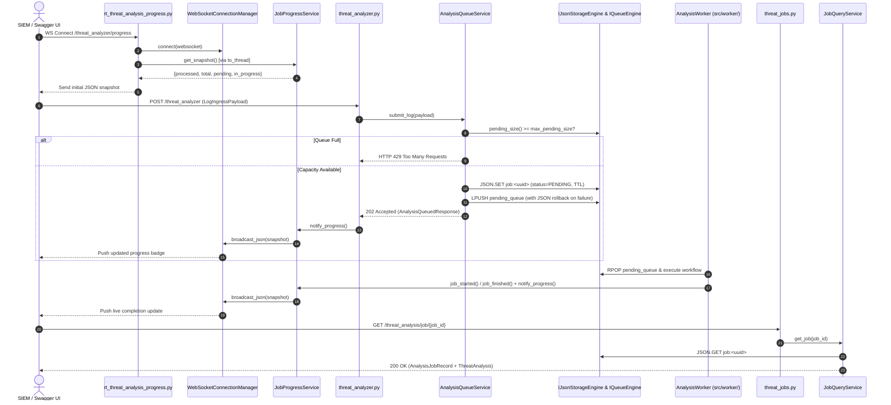

# 🌐 API, CQRS Services & Real-Time WebSockets (`src/api/`)

The **`src/api/`** module exposes the HTTP and WebSocket surface of **AI SOC Agent**. It enforces a strict **CQRS (
Command Query Responsibility Segregation)** split between asynchronous log ingestion and read-only report retrieval,
while streaming live queue progression (`processed / total`) over a server-push WebSocket channel.

---

## 🔄 Asynchronous Ingestion & Real-Time Progress Sequence

---

## 🧠 Key Engineering Decisions

1. **CQRS Command / Query Separation:**
    * **Command Side (`AnalysisQueueService`):** Handles validation, generates a UUID4 job identifier, persists the
      initial `PENDING` record in `IJsonStorageEngine`, and pushes the key into `IQueueEngine`. Includes a
      **compensatory rollback** (`delete(job_key)`) if FIFO enqueuing fails so orphaned records never accumulate.
    * **Query Side (`JobQueryService`):** Pure read-only service powering `/threat_analysis/pending`,
      `/threat_analysis/done`, and `/threat_analysis/job/{job_id}` (returning `HTTP 404` when a job has expired via
      TTL).
2. **Anti-DoS Backpressure Throttling (`HTTP 429`):**
   Before accepting new telemetry, `AnalysisQueueService` checks `pending_size() >= REDIS_QUEUE_MAX_PENDING_SIZE`. If
   the local CPU worker is saturated, excess ingestion requests are immediately rejected with `429 Too Many Requests`.
3. **Read-Only Server-Push WebSocket & Dev Swagger Badge:**
    * `/threat_analyzer/progress` is a strict **read-only broadcast channel** managed by `WebSocketConnectionManager`
      (which iterates over a frozen snapshot of active sockets and prunes stale clients automatically). Any client
      payload sent upstream receives a humorous read-only notice rather than triggering state mutations.
    * In `development` mode (`dev_setup/setup.py`), `/` redirects to `/docs` and injects `progress_badge.js` inline into
      Swagger UI so developers can watch live batch progress directly inside the API docs.
4. **Anti-Corruption Bridge (`ForensicService`):**
   Wraps `SocAgentWorkflow` to isolate HTTP infrastructure concerns, structured logging, and exception translation
   (`HTTP 500`) away from the pure AI domain.

---

## 📋 Endpoints & Components Reference

| Endpoint / Component                    | Method / Type         | Responsibility                                                                                       |
|:----------------------------------------|:----------------------|:-----------------------------------------------------------------------------------------------------|
| **`POST /threat_analyzer`**             | HTTP `202 Accepted`   | Validates `LogIngressPayload`, enforces backpressure (`429`), enqueues job, and broadcasts progress. |
| **`GET /threat_analysis/pending`**      | HTTP `200 OK`         | Lists all queued jobs waiting in FIFO order with current queue depth.                                |
| **`GET /threat_analysis/done`**         | HTTP `200 OK`         | Lists bounded history of completed/failed `AnalysisJobRecord` reports.                               |
| **`GET /threat_analysis/job/{job_id}`** | HTTP `200 OK` / `404` | Retrieves status and `ThreatAnalysis` report for a specific UUID.                                    |
| **`WS /threat_analyzer/progress`**      | WebSocket (Read-Only) | Streams `{processed, total, pending, in_progress}` JSON snapshots in real time.                      |
| **`GET /health`**                       | HTTP `200` / `503`    | Probes health across `IJsonStorageEngine`, `IVectorSearchEngine`, and `IQueueEngine`.                |
| **`dev_setup/setup.py`**                | Dev Helper            | Redirects `/` → `/docs` and embeds the live WebSocket progress badge into Swagger UI.                |