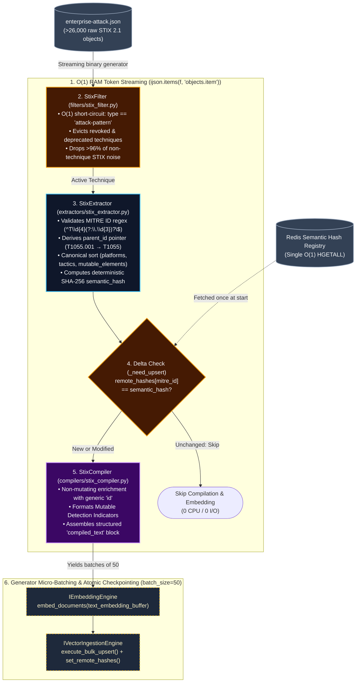

# 📥 MITRE ATT&CK STIX ETL Pipeline (`src/data_pipeline/`)

The **`src/data_pipeline/`** module implements a memory-constant (O(1) RAM) incremental ETL pipeline that streams a
raw **MITRE ATT&CK STIX 2.1** bundle (>26,000 graph objects, >50 MB) and transforms active techniques into structured
dense vector records inside RedisVL—completing a full cold ingestion in **~20 seconds on a low-power CPU (Intel® Core™
i5-10210U @ 1.60GHz, no GPU)** and **<1 second on subsequent boots**.

Built with strict **Dependency Inversion**, `StixPipeline` depends exclusively on `IEmbeddingEngine` and
`IVectorIngestionEngine`, keeping the ETL completely decoupled from HuggingFace and Redis internals.

---

## 🔄 Streaming ETL & Delta-Sync Flow

---

## ⚡ Engineering Optimizations & Hardware Scale-Up Strategy

Processing 26,000+ STIX objects on a 1.60GHz laptop CPU without a GPU required eliminating memory spikes and redundant
neural inference at every stage:

1. **O(1) Memory Streaming via `ijson`:** Instead of loading the entire >50 MB JSON tree into RAM with `json.load()`,
   `StixPipeline._build_batches()` streams `objects.item` tokens incrementally via `ijson` inside a Python generator,
   keeping memory consumption flat regardless of bundle size.
2. **Pre-Compilation SHA-256 Fingerprinting (`StixExtractor`):**
    * Arrays (`platforms`, `tactics`, `mutable_elements`) are deterministically sorted (case-insensitive / canonical
      JSON keys) before computing the SHA-256 `semantic_hash`, preventing false re-vectorization when upstream STIX
      releases reorder arrays.
    * Because `_need_upsert()` runs *before* `StixCompiler`, unchanged techniques skip both text compilation and
      Transformer embedding inference.
3. **Parent-Technique Linking & Telemetry Alignment (`StixExtractor` & `StixCompiler`):**
    * Sub-techniques (e.g., `T1055.001`) automatically derive a `parent_id` pointer (`T1055`) indexed in RedisVL, giving
      the downstream LLM hierarchical context for more accurate forensic synthesis.
    * `StixCompiler` formats `x_mitre_mutable_elements` into explicit `Mutable Detection Indicators` inside
      `compiled_text`, aligning MITRE descriptions with real system log observables.
4. **Resumable Micro-Batching (`batch_size=50`):**
    * On the target CPU (`Intel i5-10210U`), PyTorch/HuggingFace embedding computation accounts for **~95% of execution
      time**, with `batch_size=50` empirically tuned as the optimal throughput/RAM sweet spot.
    * Each batch commits its `batch_signatures` (`set_remote_hashes`) immediately after upsert (1 RTT per batch),
      enabling seamless resumption if interrupted.
    * **Production Scale-Up Path:** Moving to server CPUs or NVIDIA GPUs requires zero pipeline code changes—simply tune
      `torch.set_num_threads(N)` or switch the embedding device to `"cuda"` and raise `batch_size` to `256+`.

---

## 📋 Component Reference

| Component           | File                           | Input → Output                            | Responsibility                                                                                         |
|:--------------------|:-------------------------------|:------------------------------------------|:-------------------------------------------------------------------------------------------------------|
| **`StixFilter`**    | `filters/stix_filter.py`       | Raw STIX `dict` → `bool`                  | Short-circuit validation ensuring only active `attack-pattern` objects proceed.                        |
| **`StixExtractor`** | `extractors/stix_extractor.py` | Validated STIX `dict` → Normalized `dict` | Regex MITRE ID validation, `parent_id` derivation, canonical list sorting, and SHA-256 fingerprinting. |
| **`StixCompiler`**  | `compilers/stix_compiler.py`   | Normalized `dict` → Vector-ready `dict`   | Non-mutating enrichment with generic `id` and structured `compiled_text` assembly.                     |
| **`StixPipeline`**  | `pipelines/stix_pipeline.py`   | STIX JSON file → RedisVL index            | `ijson` streaming orchestration, delta filtering, micro-batch embedding, and incremental hash commits. |