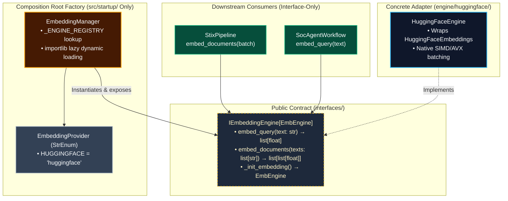

# 🧬 Embedding Module (`src/embedding/`)

The **`src/embedding/`** module abstracts dense vector generation behind a generic contract
(`IEmbeddingEngine[EmbEngine]`), decoupling both the startup STIX ETL pipeline (`StixPipeline`) and the runtime forensic
workflow (`SocAgentWorkflow`) from any specific neural embedding runtime.

---

## 🏗️ Factory & Dependency Inversion Architecture

---

## 🧠 Key Engineering Decisions

1. **Lazy Dynamic Engine Resolution (`importlib.import_module`):**
   `EmbeddingManager` maps `EmbeddingProvider` enum keys to dotted module paths inside `_ENGINE_REGISTRY` and
   dynamically imports only the active engine class at startup. Adding alternative providers (e.g., OpenAI, ONNX, or
   local APIs) never loads unused SDK dependencies into memory.
2. **Workload-Segregated Embedding Methods:**
    * **`embed_documents(texts)`:** Optimized for high-throughput batch vectorization during MITRE STIX ingestion
      (`StixPipeline`), leveraging native SentenceTransformers/PyTorch SIMD and AVX CPU vector instructions.
    * **`embed_query(text)`:** Optimized for low-latency single-log vectorization during live forensic analysis
      (`SocAgentWorkflow`).
3. **100% Unit Testability by Design (`_init_embedding()`):**
   Model loading is isolated inside `_init_embedding()` rather than inline in `__init__()`, allowing unit tests to mock
   model initialization cleanly without triggering local weight downloads or PyTorch allocations.

---

## 📋 Component Reference

| Component                         | File                                       | Responsibility                                                                                         |
|:----------------------------------|:-------------------------------------------|:-------------------------------------------------------------------------------------------------------|
| **`IEmbeddingEngine[EmbEngine]`** | `interfaces/i_embedding_engine.py`         | Generic abstract base class defining `embed_query`, `embed_documents`, and engine metadata properties. |
| **`EmbeddingProvider`**           | `providers/embedding_provider.py`          | `StrEnum` registry of supported embedding backends (`huggingface`).                                    |
| **`EmbeddingManager`**            | `embedding_manager.py`                     | Dynamic factory resolving provider strings into concrete `IEmbeddingEngine` instances.                 |
| **`HuggingFaceEngine`**           | `engine/huggingface/huggingface_engine.py` | Local SentenceTransformers adapter executing CPU-friendly dense embeddings.                            |