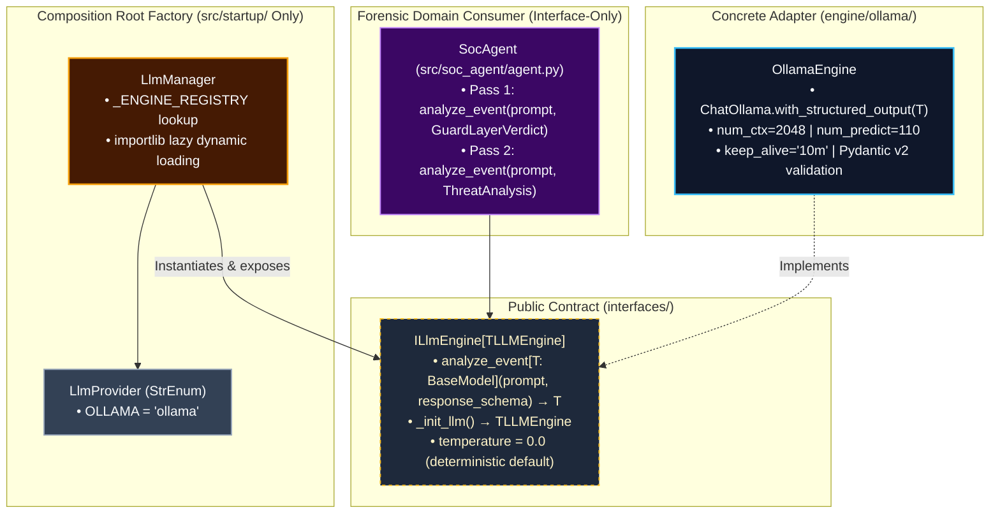

# 🤖 LLM Inference Module (`src/llm/`)

The **`src/llm/`** module abstracts structured LLM inference behind a generic contract (`ILlmEngine[TLLMEngine]`),
ensuring the forensic domain (`SocAgent`) remains completely decoupled from Ollama, LangChain, or any specific model
runtime.

---

## 🏗️ Factory & Structured Inference Architecture

---

## 🧠 Key Engineering Decisions

1. **Schema-Enforced Structured Output (`analyze_event[T: BaseModel]`):**
   Instead of parsing fragile free-form text with regular expressions, `ILlmEngine` accepts an arbitrary Pydantic v2
   `response_schema` (`GuardLayerVerdict` in Pass 1, `ThreatAnalysis` in Pass 2) and an agnostic `(role, content)`
   message list, enforcing strict schema validation before returning control to the domain layer.
2. **CPU & RAM Inference Tuning (`OllamaEngine`):**
   Configured specifically to deliver deterministic, low-latency inference on CPU-only hardware
   (`Intel Core i5-10210U`):
    * **`temperature=0.0`:** Maximizes reproducibility and deterministic forensic classification.
    * **`num_ctx=2048`:** Caps the KV-cache memory allocation and speeds up prompt evaluation on system RAM.
    * **`num_predict=110`:** Prevents local models from generating verbose prose or runaway tokens, keeping JSON
      responses tight and fast.
    * **`keep_alive="10m"`:** Retains model weights in RAM across consecutive alerts to eliminate cold-reload penalties
      while automatically reclaiming memory during idle periods.
3. **Lazy Dynamic Engine Resolution (`importlib.import_module`):**
   `LlmManager` resolves `LlmProvider` entries dynamically from `_ENGINE_REGISTRY`, ensuring alternative inference
   backends (e.g., Mistral, vLLM, OpenAI) can be added without loading unused client libraries at runtime.
4. **100% Unit Testability (`_init_llm()`):**
   Isolating `ChatOllama` instantiation inside `_init_llm()` provides a clean mocking boundary for testing
   `with_structured_output()` and `ValidationError` paths with 100% line and branch coverage.

---

## 📋 Component Reference

| Component                    | File                             | Responsibility                                                                                                |
|:-----------------------------|:---------------------------------|:--------------------------------------------------------------------------------------------------------------|
| **`ILlmEngine[TLLMEngine]`** | `interfaces/i_llm_engine.py`     | Generic abstract base class defining `analyze_event[T]`, `_init_llm`, and inference configuration properties. |
| **`LlmProvider`**            | `providers/llm_provider.py`      | `StrEnum` registry of supported LLM backends (`ollama`).                                                      |
| **`LlmManager`**             | `llm_manager.py`                 | Dynamic factory resolving provider strings into concrete `ILlmEngine` instances.                              |
| **`OllamaEngine`**           | `engine/ollama/ollama_engine.py` | Local Ollama adapter enforcing Pydantic v2 structured outputs with tuned CPU/RAM parameters.                  |