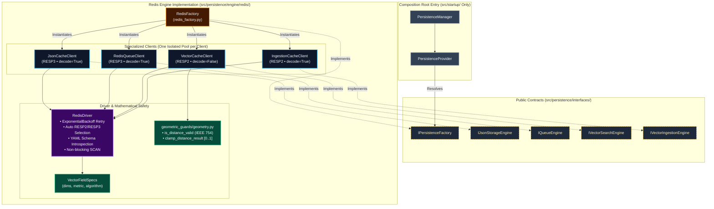

# 🗄️ Persistence Module (`src/persistence/`)

The **`src/persistence/`** module provides a unified, storage-agnostic persistence layer engineered around **Interface
Segregation (ISP)**, **Abstract Factory**, and **Dependency Inversion**. In this implementation, a single **Redis**
server fulfills four distinct operational roles—JSON document storage, FIFO job queuing, read-only KNN vector search,
and incremental vector ingestion—through strictly isolated connection pools and specialized engine clients.

---

## 🏗️ Internal Component & Contract Architecture

---

## 🧠 Key Engineering Decisions

### 1. Automatic RESP2 / RESP3 Protocol Negotiation (`RedisDriver`)

`RedisDriver` automatically selects the optimal wire protocol based on `vector_capability`:

* **RESP3 (`protocol=3`)** is enabled for `JsonCacheClient` and `RedisQueueClient` to leverage native Redis 7+
  structured responses.
* **RESP2 (`protocol=2`)** is enforced whenever `vector_capability=True` (`VectorCacheClient` and
  `IngestionCacheClient`). RediSearch (`FT.SEARCH`) in `redisvl==0.27.2` expects RESP2 `Result` objects exposing
  `.docs`; forcing RESP3 causes `redis-py` to return raw dictionaries and breaks `SearchIndex.query()`.
* **Strict Lifecycle Ownership (`owns_client=False`):** `SearchIndex.from_yaml()` is explicitly prevented from taking
  ownership of the underlying `Redis` client so `RedisDriver` retains deterministic control over connection pool
  creation and shutdown.

### 2. CQRS Split on Vector Operations (`VectorCacheClient` vs. `IngestionCacheClient`)

* **`VectorCacheClient` (`IVectorSearchEngine`, Read-Only Runtime):**
    * **Zero-Config Schema Introspection:** Reads vector dimensions, distance metrics, algorithms (`HNSW`/`FLAT`), and
      metadata field names directly from the RedisVL YAML schema at startup (`sync_lifespan_catalog`).
    * **Minimal Network Projection (`_resolve_return_fields`):** Intersects target Pydantic model fields with index
      metadata so heavy vector tensor blobs are never transferred back over the network during queries.
    * **DSL Isolation (`_build_tag_filter`):** Translates agnostic `dict[str, str]` filters into RedisVL `Tag(k) == v`
      AST expressions so domain layers never import `redisvl`.
    * **Geometric & IEEE 754 Guards:** Validates query vector dimensionality in $O(1)$ (`VectorDimensionMismatchError`),
      traps `NaN`/`Inf` distances (`is_distance_valid`), and normalizes raw metric distances into a `[0.0, 1.0]`
      similarity score (`clamp_distance_result`).
* **`IngestionCacheClient` (`IVectorIngestionEngine`, Ephemeral Boot Writer):**
    * **Delta-Sync via Semantic Fingerprints:** Uses atomic `HGETALL`/`HSET` operations on a dedicated hash registry
      (`_semantic_hashes_key`) so unchanged MITRE STIX documents are skipped—saving massive CPU cycles during startup.
    * **Flat Redis Hash Normalization (`_normalize_document_types`):** Packs float vectors into C-contiguous `float32`
      byte buffers via NumPy, joins Python lists into comma-delimited strings for Redis `TAG` fields, and serializes
      nested dicts to JSON strings.

### 3. Self-Pruning FIFO Queue (`RedisQueueClient`)

* Implements a strict FIFO queue using `LPUSH` (enqueue) and `RPOP` (dequeue), paired with a bounded completion list
  (`LPUSH` + `LTRIM` capped at `max_done_history`).
* **TTL-Aware Pipeline Pruning:** Because job records in `JsonCacheClient` carry a TTL, `get_pending()` and `get_done()`
  verify key existence in a single non-transaction Redis pipeline (`EXISTS`) and automatically prune expired job IDs
  (`LREM`) to prevent stale queue drift.

---

## 📋 Component Reference

| Component                                        | Contract                 | Protocol & Decoding   | Responsibility                                                                                        |
|:-------------------------------------------------|:-------------------------|:----------------------|:------------------------------------------------------------------------------------------------------|
| **`PersistenceManager` / `PersistenceProvider`** | `IPersistenceFactory`    | —                     | Factory resolution in `src/startup/` (never imported by business logic).                              |
| **`RedisDriver`**                                | —                        | RESP2 or RESP3        | Connection pooling, `ExponentialBackoff` retries, `SCAN` key iteration, and YAML index introspection. |
| **`JsonCacheClient`**                            | `IJsonStorageEngine`     | RESP3, `decode=True`  | CRUD operations (`JSON.GET`, `JSON.SET` at `$`) with automatic key `EXPIRE` TTL.                      |
| **`RedisQueueClient`**                           | `IQueueEngine`           | RESP3, `decode=True`  | FIFO job queue (`LPUSH`/`RPOP`), bounded completion history (`LTRIM`), and pipelined TTL pruning.     |
| **`VectorCacheClient`**                          | `IVectorSearchEngine`    | RESP2, `decode=False` | Read-only KNN similarity search, tag filtering, IEEE 754 distance clamping, and Pydantic hydration.   |
| **`IngestionCacheClient`**                       | `IVectorIngestionEngine` | RESP2, `decode=True`  | Bulk vector upsert (`search_index.load`), `float32` binary packing, and semantic hash delta tracking. |