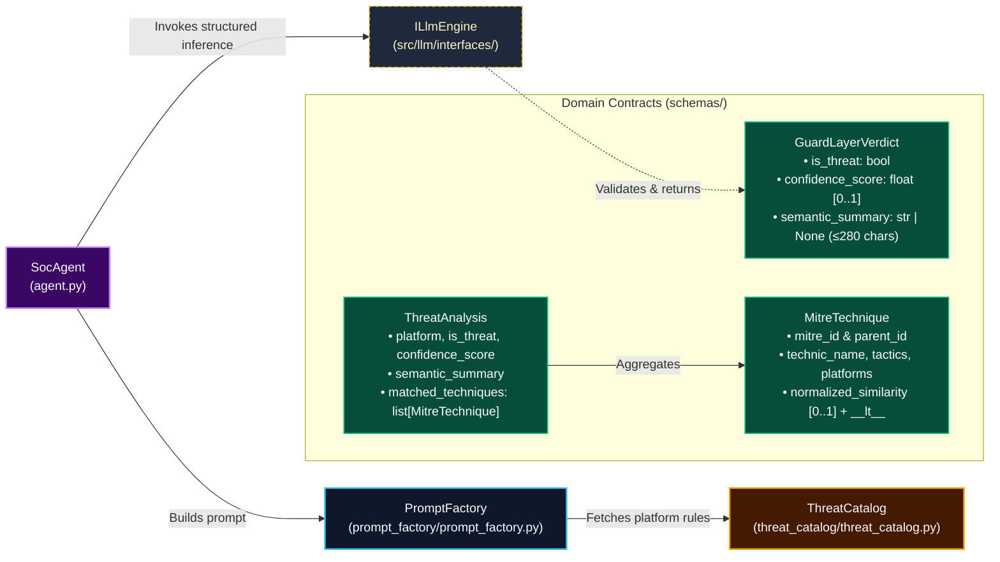

# 🧠 Pure Forensic AI Domain (`src/soc_agent/`)

The **`src/soc_agent/`** module encapsulates the core cybersecurity intelligence of **AI SOC Agent**. It contains zero
infrastructure drivers, database clients, or HTTP dependencies—communicating with the outside world strictly through
`ILlmEngine` and strongly-typed Pydantic v2 domain contracts.

---

## 🏗️ Domain Component Structure

---

## 🧠 Key Engineering Decisions

1. **Anti-Paranoia Classification & Vocabulary Anchoring (`PromptFactory`):**
    * Enforces strict classification rules that explicitly whitelist routine administrative tasks, signed updaters, and
      expected background activity so SOC analysts are not flooded with false positives.
    * Instructs the LLM to rewrite suspicious events using canonical **MITRE ATT&CK terminology** (e.g., *Process
      Injection*, *OS Credential Dumping*, *Steal Application Access Token*) capped at 280 characters, aligning the
      query embedding space with `StixCompiler` index records.
    * Enforces `semantic_summary = null` on benign events to minimize CPU token generation overhead.
2. **11-Platform MITRE ATT&CK Enterprise v19.2 Registry (`ThreatCatalog`):**
   Maps every official STIX platform (`windows`, `macos`, `linux`, `pre`, `office suite`, `identity provider`, `saas`,
   `iaas`, `network devices`, `containers`, `esxi`) to platform-specific detection guidelines, preventing
   cross-ecosystem hallucinations.
3. **Strict Domain Contracts (`schemas/`):**
    * **`GuardLayerVerdict`:** Internal LLM-to-Workflow contract bounding `confidence_score` to `[0.0, 1.0]` and
      `semantic_summary` to `max_length=280`.
    * **`MitreTechnique`:** Represents a RedisVL candidate enriched with `parent_id` hierarchy and implements `__lt__`
      on `normalized_similarity` for clean native sorting.
    * **`ThreatAnalysis`:** Unified output schema guaranteed whether an event exits early as benign or completes full
      MITRE correlation.

---

## 📋 Component Reference

| Component               | File                               | Responsibility                                                                                   |
|:------------------------|:-----------------------------------|:-------------------------------------------------------------------------------------------------|
| **`SocAgent`**          | `agent.py`                         | Stateless forensic agent orchestrating prompt creation and structured `ILlmEngine` execution.    |
| **`PromptFactory`**     | `prompt_factory/prompt_factory.py` | Pure functional builder generating deterministic system/user message tuples.                     |
| **`ThreatCatalog`**     | `threat_catalog/threat_catalog.py` | Fail-fast registry of MITRE ATT&CK v19.2 detection guidelines across all 11 supported platforms. |
| **`GuardLayerVerdict`** | `schemas/first_guard_layer.py`     | Pydantic schema enforcing binary triage, calibrated confidence, and concise semantic summary.    |
| **`MitreTechnique`**    | `schemas/mitre_technique.py`       | Pydantic schema representing a scored MITRE ATT&CK technique or sub-technique (`parent_id`).     |
| **`ThreatAnalysis`**    | `schemas/threat_analysis.py`       | Final end-to-end forensic report contract returned by `SocAgentWorkflow`.                        |