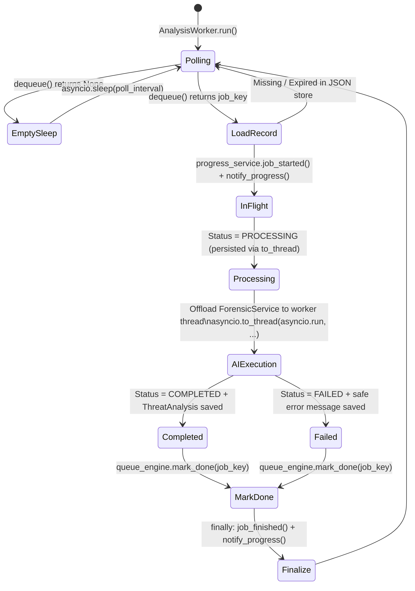

# ⚙️ Background Analysis Worker (`src/worker/`)

The **`src/worker/`** module implements `AnalysisWorker`, an asynchronous FIFO queue consumer that decouples CPU-heavy
AI inference from the FastAPI ASGI event loop.

---

## 🔄 Job Execution & Thread Offloading Lifecycle

---

## 🧠 Key Engineering Decisions

1. **Zero ASGI Event Loop Starvation (`asyncio.to_thread`):**
   On CPU-only hardware (`Intel Core i5-10210U`), embedding generation and Ollama inference are compute-bound operations
   that take several seconds per log. `AnalysisWorker` offloads both synchronous Redis I/O (`dequeue`, `get`, `insert`,
   `mark_done`) and the entire `ForensicService.analyze_and_report()` pipeline into worker threads via
   `asyncio.to_thread`, ensuring HTTP routes and WebSocket heartbeats remain instantaneous.
2. **Guaranteed Progress Accounting (`try / finally`):**
   `job_started()` and `job_finished()` bracket the entire job lifecycle inside a `try / finally` block, guaranteeing
   accurate `in_progress` and `processed / total` WebSocket metrics even when a job is malformed or fails inference.
3. **Safe Failure Isolation:**
   If a workflow raises an exception, `AnalysisWorker` transitions the job to `JobStatus.FAILED` with a sanitized error
   string (`"Forensic analysis failed."`), records it in the bounded `done` history (`mark_done`), and continues polling
   without crashing the background task.