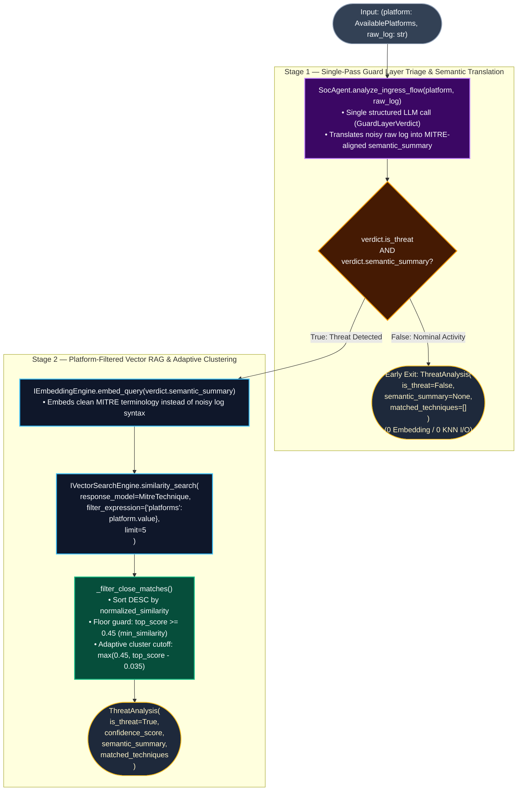

# 🔀 Forensic Workflow Orchestrator (`src/workflow/`)

The **`src/workflow/`** module orchestrates the end-to-end AI forensic pipeline via `SocAgentWorkflow`. Designed
specifically to achieve high accuracy and low latency on **CPU-only hardware**, it pairs a **single-pass Guard Layer LLM
inference** with **platform-filtered KNN vector retrieval** and **adaptive similarity clustering**.

---

## 🔄 Two-Stage Forensic Pipeline Flow

---

## 🧠 Key Engineering Decisions

1. **Single-LLM-Call Architecture (Zero Second-Pass Generation Penalty):**
   Running two sequential LLM passes on a low-power CPU doubles latency. Instead, Stage 1 (`GuardLayerVerdict`) performs
   both **binary security triage** and **semantic query rewriting** in a single structured call—translating raw
   telemetry into a dense 20–35 word MITRE-aligned signature (`semantic_summary`). Stage 2 then resolves exact MITRE
   ATT&CK techniques deterministically via dense vector search without invoking the LLM a second time.
2. **Early Exit for Benign Telemetry:**
   If `is_threat` is `False`, `semantic_summary` is forced to `null` (saving output generation tokens) and the workflow
   returns immediately—bypassing neural query embedding and Redis KNN search completely.
3. **Ecosystem Isolation via Tag Pre-Filtering:**
   `similarity_search` passes `filter_expression={"platforms": platform.value}` so Windows logs are never matched
   against Linux-only or ESXi-only techniques.
4. **Adaptive Top-K Clustering (`_filter_close_matches`):**
   Rather than blindly returning all `knn_limit=5` neighbors (which often includes irrelevant tail matches), the
   workflow:
    * Discards all results if the best match falls below `min_similarity = 0.45`.
    * Retains only candidates within `similarity_delta = 0.035` of `top_score`, automatically returning 1 precise
      technique when a clear winner emerges or multiple closely clustered sub-techniques when behavior spans sibling
      mechanisms.